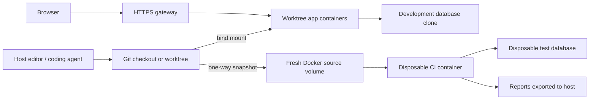

# Architecture

## Development

The host owns Git, source files and the editor. Main examples use shared database
services. Each interactive worktree has a separate Compose project and database
clone. Routing follows the project hostname and branch slug. Stopping a worktree
does not remove its Git checkout.

The samples are kept in this repository so a new user can try the complete flow.
The CI runner also supports separate application repositories. Its adapter makes
the repository layout explicit; see [CI](../operations/ci.md).

## CI

A run captures the current input, records a content fingerprint, and copies it to
a fresh Docker volume with automatic image-volume population disabled. Runtime
images are resolved to an existing local image ID. A run receives a new network
and its declared service containers; the samples do not use development databases.

The runner checks the copied source before executing gates. Reports describe the
frozen input and whether the host source still matches at completion. A passing
run is evidence for that snapshot, not for edits made after it was captured.

Dependency downloads may still use the network. There is no persistent dependency
cache in this version. A fresh install costs time but avoids sharing host binaries
or mutable dependencies between runs.

## Trust boundaries

Compose files, project hooks and CI adapters are executable configuration. Use
reviewed checkouts. A private bridge and resource labels prevent accidental
cross-talk; they are not a sandbox for hostile code. Host-scoped CI steps run on
the host with the user's privileges.

The optional dashboard mounts the Docker socket, which grants control of the
local Docker daemon. Its password does not make it suitable for public hosting.
Keep its gateway binding on loopback unless you deliberately configure a trusted
remote-access arrangement.

Filename exclusions keep common environment/dependency files out of CI snapshots.
They are not a general secret scanner. Avoid committing secrets or putting them
in arbitrary nonignored files. Reports may contain application output and remain
local by default.

Kubernetes support is limited to local DNS integration for Docker Desktop. It
does not provision a Kubernetes cluster, ingress controller or application.
